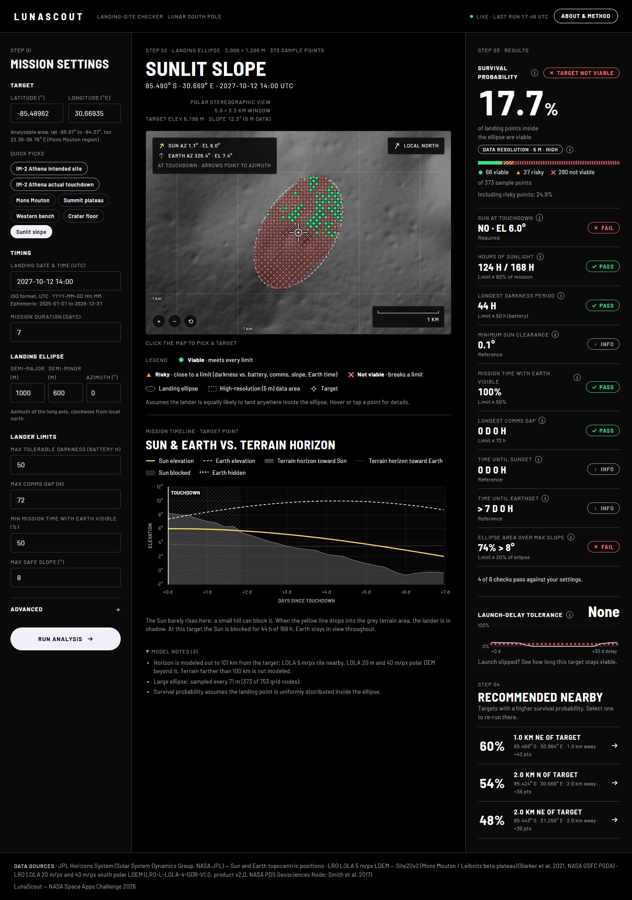
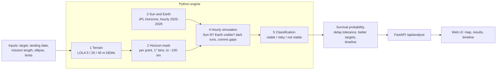

<!-- Developed with assistance from Claude (Anthropic). Reviewed and integrated by the LunaScout team. -->
# LunaScout

**Plan for where you'll land, not where you aim.**

A lander never touches down exactly on its target. Near the lunar south pole the Sun stays only a few degrees above the horizon, so a few hundred metres can separate sunlight from shadow. LunaScout is a single-screen web app that evaluates the **whole landing ellipse**: for every sample point it computes the terrain horizon from real LRO LOLA topography and the Sun and Earth positions from JPL Horizons, simulates the mission hour by hour, and returns a **survival probability**, a **launch-delay tolerance** and **better nearby targets**.

Built for the NASA Space Apps Challenge 2026, challenge *Lunar Landing Site Navigator*.

- **Live app (no login):** https://lunascout.web.app
- **Source:** https://github.com/lauta-r0/lunar-landing--
- **Demo:** [DEMO LINK]
- **Planning aid, not an operational tool.**



## Why the whole ellipse

- Inside one 1 km-wide landing area on the 5 m Mons Mouton terrain, sample points range from **0 % to 100 %** of a 7-day mission in sunlight (several dates; `docs/validation/sunlight_spread_in_ellipse.json`). Evaluating only the target hides that spread.
- Real-world reminder: in March 2025 the IM-2 "Athena" lander touched down a few hundred metres from its target near Mons Mouton, tipped over in a crater about 20 m across and could not generate enough power; the mission ended about 12–13 hours later (Hancock et al. 2026). LunaScout does **not** reproduce that loss: the terrain there was sunlit at the scale of the available elevation data, and the crater is smaller than any available model can show. See [docs/athena_replay.md](docs/athena_replay.md).

## How it works



1. **Terrain.** Real LOLA topography around the target: 5 m/px near Mons Mouton, 20 m and 40 m/px south-polar DEMs farther out.
2. **Horizon mask.** For each sample point, the terrain horizon elevation in every direction (1° bins), by ray marching along great circles with the Moon's curvature, out to about 100 km. Horizons are precomputed on a grid (50 m on the 5 m tile, 100 m north of it) and computed on the fly for small ellipses and for the target.
3. **Sun and Earth.** Positions from JPL Horizons, queried once (hourly, 2025–2028) and stored as unit vectors in the Moon Mean-Earth/polar-axis frame; azimuth and elevation at each point are computed geometrically. The app never calls Horizons live.
4. **Hourly simulation.** Each hour, is the centre of the Sun / of the Earth above that point's terrain horizon? Observer height 2 m, no refraction.
5. **Classification.** *Not viable* if a limit is broken (slope, darkness longer than the battery, comms gap, too little Earth time, no Sun at touchdown); *risky* if within the risk margin of a limit; *viable* otherwise. Survival probability = viable points ÷ all points, **assuming the landing is uniformly distributed inside the ellipse**. The analysis is repeated for each launch delay and for nearby curated sites and offsets. Exact rules: [CONTRACT.md](CONTRACT.md) §4.4.

More detail: [engine/ENGINE.md](engine/ENGINE.md), [engine/EPHEMERIS.md](engine/EPHEMERIS.md).

## Data sources

| Data | Source | Use |
|---|---|---|
| Sun and Earth positions | [JPL Horizons System](https://ssd.jpl.nasa.gov/horizons/) (NASA JPL) | Hourly ephemeris 2025–2028 |
| 5 m/px terrain (Site20v2, Mons Mouton) | [LRO LOLA site DEMs, NASA GSFC PGDA](https://pgda.gsfc.nasa.gov/products/78); Barker et al. 2021, doi:10.1016/j.pss.2020.105119 | Heights, slopes, horizon, hillshade |
| 20 m and 40 m/px terrain | [LRO LOLA polar GDR, NASA PDS Geosciences Node](https://pds-geosciences.wustl.edu/lro/lro-l-lola-3-rdr-v1/lrolol_1xxx/data/lola_gdr/polar/img/) (LRO-L-LOLA-4-GDR-V1.0 v2.0; Smith et al. 2017) | Terrain outside the 5 m tile, far-field horizon |
| Shadow reference | [LROC QuickMap](https://quickmap.lroc.asu.edu/) (ASU / NASA) | Validation only |

Raw DEMs and derived grids are **not** in git (too large); they stay under their original NASA terms.

## Run locally

Python 3.12 or newer. The runtime data (`data/raw/*.tif`, `data/derived/`, `data/ephemeris/sun_earth_vectors.npz`) is git-ignored and must be generated first (downloads from NASA; the precompute takes a while and is resumable):

```bash
pip install -r engine/requirements.txt
python scripts/fetch_ephemeris.py                       # Horizons -> data/ephemeris/
python scripts/prepare_dem.py                           # 5 m tile from PGDA (use --skip-download if already there)
python scripts/prepare_regional_dem.py                  # 20 m / 40 m crops from PDS
python scripts/prepare_dem.py --skip-download           # hillshade over all levels
python scripts/precompute_horizons.py                   # 50 m horizon grid
python scripts/precompute_horizons.py --area regional   # 100 m horizon grid
```

API (from the repo root; startup takes a few seconds while the data loads, about 600 MB of memory):

```bash
pip install -r api/requirements.txt
uvicorn api.main:app --port 8000
```

Web (no build step; never open via `file://`):

```bash
cd web
python -m http.server 5500
# open http://localhost:5500
```

By default a local page uses the public API. To use your local API, set `window.LUNASCOUT_API = "http://localhost:8000/api"` before `config.js` loads. If the API is unreachable the app offers `fixtures/sample_response.json` behind a visible **SAMPLE DATA — API OFFLINE** badge; sample data is never shown without it. See [web/README.md](web/README.md) and [api/README.md](api/README.md).

## Deploy

API on Google Cloud Run (2 vCPU, 2 GiB, one warm instance), web app on Firebase Hosting with `/api/**` rewritten to Cloud Run so both share one origin. Commands and rollback: [api/DEPLOY.md](api/DEPLOY.md).

## Tests

```bash
pip install -r requirements-dev.txt
python -m pytest engine/tests -q        # engine and ephemeris
python -m pytest api -q                 # API
python -m pytest tests/validation -v    # independent checks against the live deployment (network)
```

`[TO VERIFY]` re-run all three on the final commit and record the pass counts here. At the time of the engine notes, `engine/tests` reported 57 passed; the validation suite reported 56 passed and 1 documented deviation (a malformed date returns 400 instead of 422).

## Validation summary

Independent report, figures and reproducible tests: [docs/validation.md](docs/validation.md).

- **Sunlight vs. LROC QuickMap.** On three dates (about 3,000 points each), LunaScout's lit/shadow result agrees with QuickMap's independent terrain-shadow model on **95.5–98.0 %** of points (Cohen's kappa **0.90–0.93**). QuickMap shadows are a model, not observations.
- **Ephemeris vs. JPL Horizons.** Sun and Earth azimuth/elevation returned by the API match direct Horizons queries to **≤ 0.0013°** at our sites.
- **Whole ellipse.** Points inside one 1 km-wide landing area range from 0 % to 100 % of a 7-day mission in sunlight.
- **IM-2 "Athena" test case.** LunaScout and QuickMap both show the touchdown site sunlit for its first hours; the loss came from the lander tipping over in a ~20 m crater, which no available terrain model resolves.
- **Speed.** Server compute for uncached default requests with recommendations: 240–440 ms in our own check on 15 Nov 2026 (six sites); the contract target is under 3 s.

## Limitations

- **Coverage:** one region around Mons Mouton / Leibnitz beta plateau (about 24 × 42 km, latitude about −86.0 to −84.4). Targets outside it get an `out_of_coverage` message with a suggested target.
- **Terrain resolution:** 5 m/px only on the Site20v2 tile, **20 m/px** elsewhere (including both IM-2 sites). Boulders and craters smaller than a pixel are not resolved and 20 m slopes underestimate steepness. The 5 m height error (0.3–0.5 m RMS) is not propagated.
- **Horizon** is modelled out to about 100 km; farther terrain is not.
- **Lander model:** assumed upright, panels and antenna 2 m above the ground; attitude, tip-over dynamics and panel orientation are not modelled (tip-over risk enters only through DEM slope).
- **Statistics:** uniform landing distribution inside the ellipse; 1 h time step; the Sun counts as lit when its centre clears the horizon.
- **Not modelled:** thermal behaviour (darkness duration is the proxy for cold), relay satellites, descent lighting, launch-window orbital constraints, eclipses.
- **Ephemeris** covers 2025-01-01 to 2028-12-31, one reference direction (Earth parallax ≤ 0.013° within 150 km).

## Use of AI

The team came up with the idea and defined the problem, the requirements and the design decisions, and reviewed all results. Claude (Anthropic) assisted with the code, the tests, the validation scripts and the documentation, including the submission texts. Every AI-assisted code file starts with a header comment saying so. No AI-generated images, video or voices are used. `[TO VERIFY by the team: adjust to what actually happened]`

## Team

**CD Band** — Systems Engineering students, ORT Uruguay: Lautaro Montes, Agustin Guerequiz, Francisco Castelli, Sebastián Luciardi.

## License

Code: MIT (proposed; `[TO VERIFY]` the team confirms and adds a `LICENSE` file with the copyright holder). Data: LRO LOLA, JPL Horizons and LROC products remain under their original NASA terms; they are not redistributed in this repository.

## Acknowledgements and references

NASA JPL Horizons; NASA GSFC PGDA; NASA PDS Geosciences Node; LROC (ASU/NASA); Barker et al. 2021; Smith et al. 2017; Hancock et al. 2026 (doi:10.3847/PSJ/ae732f). Libraries: NumPy, SciPy, rasterio, pyproj, Pillow, FastAPI, Uvicorn, Pydantic, Chart.js, pytest. Font: Barlow (SIL OFL 1.1). Full list with licences: [docs/submission/project_page.md](docs/submission/project_page.md).
