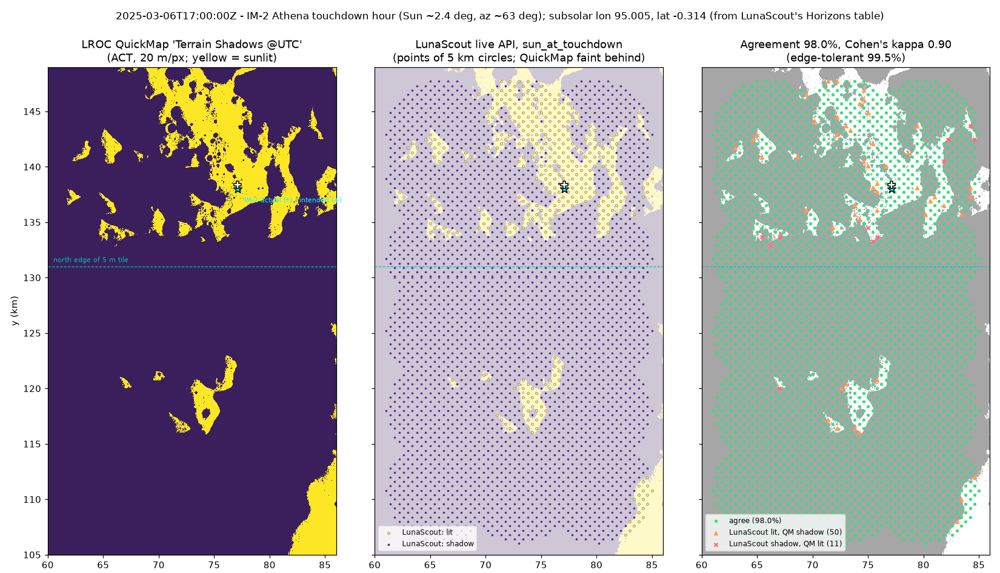
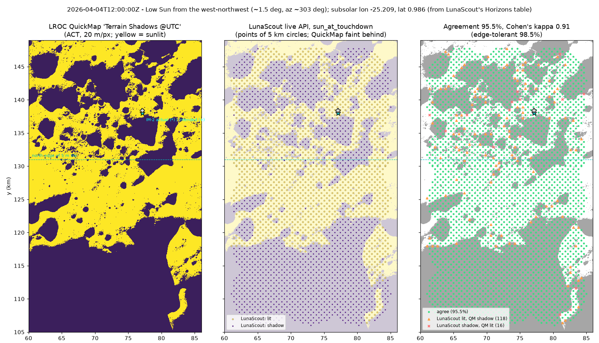
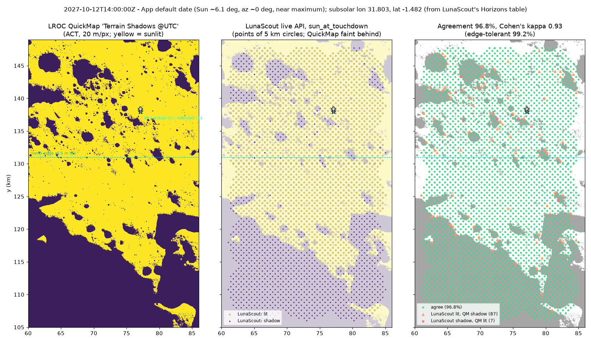

<!-- Developed with assistance from Claude (Anthropic). Reviewed and integrated by the LunaScout team. -->
# LunaScout — independent validation report

Reviewer: Agent 06 (independent of the engine, API and web authors). Date: 2026-11-15.
System under test: the **live deployment** — app https://lunascout.web.app, API
https://lunascout.web.app/api (Firebase rewrite) and https://lunascout-api-855190992553.southamerica-east1.run.app/api
(Cloud Run), schema 1.3. The engine was **not** run locally.

Every number below is either **MEASURED** (produced by a script in `tests/validation/`, raw output in
`docs/validation/*.json`) or marked **INFERENCE**. External facts carry a source; quotes are under 15 words.

Reproduce everything (network required; tests skip themselves if the API is down):

```
python -m pytest tests/validation -v            # 57 tests (56 pass, 1 known deviation xfail), ~4 min
python tests/validation/quickmap_compare.py     # QuickMap comparison + figures (~10 min, cached afterwards)
```

---

## 1. Summary

| # | Check | Result (MEASURED) | Verdict | Evidence |
|---|---|---|---|---|
| 1 | Sunlit/shadow vs. LROC QuickMap "Terrain Shadows @UTC" (independent model), 3 dates, ~2,980 points each | Agreement **98.0 % / 95.5 % / 96.8 %**, Cohen's kappa **0.90 / 0.91 / 0.93**; 98.5–99.5 % when points on a QuickMap shadow edge (±1 px) are tolerated | **PASS** | §2, `validation/quickmap_vs_lunascout_*.png`, `quickmap_comparison.json` |
| 2 | Residual bias (LunaScout lit, QuickMap dark) explained? | With observer height 0.1 m instead of 2 m, the bias disappears (8 vs 15 disagreements instead of 126 vs 10) | **PASS** (explained by a documented choice) | §2.3, `observer_height_test.json` |
| 3 | IM-2 site lit in QuickMap for the first 15 h after touchdown? | Lit in all 15 hourly QuickMap frames at the actual and intended sites; LunaScout also lit 15/15 | **PASS** (consistent) | §3, `quickmap_comparison.json` → `athena_site_hourly` |
| 4 | Subsolar point: LunaScout table vs. QuickMap (ACT SPICE service) | Δlon ≤ 0.0005°, Δlat ≤ 0.0007° (2 epochs) | **PASS** | §4.2 |
| 5 | API Sun/Earth az/el vs. direct JPL Horizons (DEM center, Athena, 3 random hours 2025–2028) | Sun ≤ **0.0005°**, Earth ≤ **0.0013°** (tol. 0.02° / 0.05°) | **PASS** | §4, `ephemeris_crosscheck.json` |
| 6 | Shackleton (outside coverage): API refuses; table + `local_az_el` vs. Horizons, incl. known 2027-01-01 value | API 400 `out_of_coverage`; Sun ≤ 0.00005°, Earth ≤ 0.011° | **PASS** | §4 |
| 7 | Max Sun elevation over 2027 = (90 − \|lat\|) + 1.54° | 6.113° vs 6.113° (DEM center); 6.747° vs 6.749° (Athena) | **PASS** | §5 |
| 8 | +14.77 d / +29.53 d shifts | Half month: Sun az +179.5°, touchdown-lit agreement 16.8 %. Full month: az +0.2°, agreement 100 % | **PASS** | §5 |
| 9 | Monotonicity (slope, darkness, comms gap, Earth %), 4 scenarios × 21 settings | Never violated, for both probabilities | **PASS** | §5 |
| 10 | `delay_curve[0]` = summary; delay curve = fresh runs k days later; `delay_tolerance_days` rule | Equal in all 4 scenarios; fresh runs identical (k = 1, 3, 5) | **PASS** | §5 |
| 11 | Contract shape + internal consistency (lit rule, metrics from timeseries, counts, CONTRACT 4.4 classes, recommendations) | 20/20 checks, 4 scenarios | **PASS** | `test_contract_live.py` |
| 12 | Errors: out of coverage, out of ephemeris, 12 invalid inputs | All correct **except** malformed date → **400** `invalid_request` instead of 422 | **PASS with 1 deviation (P2)** | §6 |
| 13 | Timing, 10 varied uncached calls with recommendations (2 runs) | Server compute p50 **159–169 ms**, p95 **225–270 ms**; wall clock (Uruguay → Firebase → Cloud Run) p50 **1.6 s**, p95 **1.9–2.2 s** | **PASS** (< 3 s) | §6 |
| 14 | Edge cases: 50 m ellipse, 5 km ellipse, 30-day mission | 200 OK; 73 / 241 / 384 points; ≤ 2.1 / 2.1 / 2.6 s wall (compute ≤ 1.1 / 0.5 / 1.0 s) | **PASS** | §6 |
| 15 | UI: client-side area check, API errors, sample badge only when API down, phone width, English, no NASA logos, no mojibake, About links | All as expected (details and P2 polish in §6) | **PASS** | `validation/ui_*.jpg` |
| 16 | Athena replay reasoning | Data and arithmetic correct; some framing and two facts need correction | **PARTIAL** | §3 |
| 17 | Claims audit (README, About, CONTEXT, docs) | 3 P1 wording problems, several stale statements | **ACTION NEEDED** | §7 |
| — | Private-window test | Not run: the in-app browser has no private mode. Verified instead: no login, no cookies, only `localStorage` key `lunascout.inputs.v1` (remembered inputs); page works after clearing it | **NOT RUN** (substitute check passed) | §6 |
| — | Published average-illumination maps (Mazarico et al. 2011) | Not done (time); QuickMap comparison used instead | **NOT RUN** | — |

**No P0 issue found** (no wrong result, no broken demo path).

---

## 2. Illumination: LunaScout vs. LROC QuickMap

### 2.1 Method (MEASURED)
- **Reference:** QuickMap layer *Terrain Shadows @UTC (80S,20mpp)* (ACT; https://quickmap.lroc.im-ldi.com, the
  site lroc.asu.edu now redirects there). Its description: a 20 m/px map where "Pixel values of 1 correspond to
  sunlit pixels", computed using "the center of the Solar Disc" (same rule as LunaScout), accurate to 0.5° in
  subsolar longitude and 0.1° in latitude. It is an **independent** implementation on a different DEM
  aggregation.
- The layer is served as float32 tiles per subsolar point
  (`qts2d.actgate.com/tiles/pqmi_cloud/lunar-steresp/{z}/{x}/{y}.flt?d_pos=lon,lat`). The tile grid was read from
  QuickMap's own config (projection 27: polar stereographic, sphere 1,737,400 m, `lat_0=-90`, `lon_0=0`, the
  **same CRS** as LunaScout), so no reprojection was needed. Zoom 8 (28 m/px).
- **LunaScout side:** 18 live `/api/analyze` calls per date (5 km circles on a grid covering the whole analyzable
  area), `mission_days=1`, reading `points[].sun_at_touchdown` (lit at the landing hour, observer 2 m).
- Subsolar point for QuickMap = LunaScout's Horizons table at that hour (checked against QuickMap's own value, §4.2).
- Script: `tests/validation/quickmap_compare.py`.

### 2.2 Results (MEASURED)

| UTC (hour) | Sun at DEM center | Points | Lit (LunaScout / QuickMap) | Agreement | Kappa | Edge-tolerant | LS lit & QM dark / LS dark & QM lit | 5 m tile / 20 m area |
|---|---|---|---|---|---|---|---|---|
| 2025-03-06 17:00 (IM-2 touchdown) | az 63°, el 2.4° | 2,980 | 12.3 % / 11.0 % | **98.0 %** | **0.90** | 99.5 % | 50 / 11 | 99.4 % / 95.8 % |
| 2026-04-04 12:00 (low Sun from WNW) | az 303°, el 1.5° | 2,980 | 49.2 % / 45.8 % | **95.5 %** | **0.91** | 98.5 % | 118 / 16 | 97.5 % / 92.4 % |
| 2027-10-12 14:00 (app default) | az 0°, el 6.1° | 2,980 | 65.5 % / 62.8 % | **96.8 %** | **0.93** | 99.2 % | 87 / 7 | 98.1 % / 95.0 % |





UI screenshots of both tools for the IM-2 hour: `validation/side_by_side_ui_2025-03-06.png`
(QuickMap layer panel showing Requested Time 2025-03-06T17:00 and its subsolar point; LunaScout run at the
actual touchdown site).

### 2.3 Interpretation
- MEASURED: agreement is better on the 5 m tile (97.5–99.4 %) than in the 20 m area north of y = 131 km
  (92.4–95.8 %), and most remaining disagreements sit on shadow edges.
- MEASURED: disagreements are one-sided: LunaScout says lit where QuickMap says shadow 3–17 times more often than
  the reverse. Re-running 2026-04-04 with `observer_height_m = 0.1` (instead of 2 m) gives 8 vs 15 (balanced)
  and a lit fraction of 41.8 % vs QuickMap 43.0 % (`observer_height_test.json`; note: the 0.1 m runs use the
  on-the-fly sample grid, 584 points, not the same points as the 2 m runs).
- INFERENCE: QuickMap evaluates shadows at the surface, LunaScout at 2 m (solar-array height, a deliberate choice).
  The residual bias is therefore expected, not an error.

---

## 3. Athena (IM-2) review

### 3.1 Facts (sources)
| Fact | Value | Source |
|---|---|---|
| Intended site | −84.78, 29.13 E (2 decimals only) | LROC featured image 1401 "IM-2 Landing Region", 26 Feb 2025, https://lroc.im-ldi.com/images/1401 |
| Actual touchdown | 84.79059° S, 29.19567° E; "came to rest on its side in a crater" | Hancock et al. 2026, PSJ, doi:10.3847/PSJ/ae732f, Sect. 1.2 |
| Same, LROC | 84.7906° S, 29.1957° E | LROC 1408 "IM-2 Athena Seen Obliquely", NAC M1495922531LR [NASA/GSFC/Arizona State University], https://lroc.im-ldi.com/images/1408 |
| **Crater size (primary)** | "ended up on its side within a 20-meter diameter crater" | LROC 1408 (same page). Hancock et al. Fig. 13: "a ∼20 m diameter shallow crater" |
| Closer LROC view | NAC M1496181900LR, 11 Mar 2025 | https://lroc.im-ldi.com/images/1409 |
| Touchdown time | **"2025 March 6 at 17:28 UTC"** (Hancock); "12:31 p.m. EST (1731 GMT)" (Space.com, quoted in our docs) | Hancock et al. 2026; docs/athena_replay.md |
| Distance from target | IM: 250 m; NASA: "more than 1,300 feet (400 meters)"; Hancock: "about 500 m away" | https://spacepolicyonline.com/news/im-2-mission-ends-one-day-after-lunar-landing/ ; Hancock et al. |
| Why it failed | "landed orientation and location resulted in a power-negative state" | Hancock et al. 2026 |
| When it ended | Hancock: "approximately 12 hr after touchdown"; SpacePolicyOnline: "about 13 hours" | both above |
| Intended-site coordinates in Hancock? | **No** — the paper gives none (checked the text) | Hancock et al. 2026 |

### 3.2 The 250 / 369 / 500 m discrepancy (MEASURED)
The LROC intended site is published with two decimals (±0.005°). At −84.78° that is ±152 m north–south but only
±14 m east–west. Over that rounding box the distance to the actual touchdown ranges **238–511 m** (369 m at the
nominal values). So IM's 250 m, NASA's "more than 400 m" and Hancock's 500 m are all compatible with the LROC
coordinates. Use "a few hundred metres (250–500 m depending on the source)" rather than one number.

### 3.3 Our runs (MEASURED, live API)
- UI, actual site, default 1000 × 600 m ellipse, 10 days: **91.6 %** viable (175 viable / 11 risky / 5 not viable).
- Hourly check, first 15 h (2025-03-06 17:00 → 07-07:00 UTC): LunaScout target lit 15/15 h, Sun 2.4–3.0° high,
  Sun clearance above the DEM horizon 1.6–2.6°. **QuickMap: lit in 15/15 frames** at the actual site and at the
  intended site. Two independent models agree that the site was sunlit at DEM scale.

### 3.4 Critical review of `docs/athena_replay.md`
Correct:
- It honestly says the model does not reproduce the failure; inputs and arithmetic are right (to hide the whole
  disk with 1.6° clearance, local relief must rise ~0.33 m at 10 m, ~0.65 m at 20 m, ~1.6 m at 50 m).
- "The crater is about one 20 m pixel" is true: a 20 m crater cannot be represented in a 20 m DEM.

Needs correction or softening:
1. **Cause.** The primary source attributes the power loss to "orientation and location"; LROC/Hancock call the
   crater *shallow*. INFERENCE: for an *upright* lander with panels 2 m up, a ~20 m shallow crater would not
   necessarily shadow the panels (rim height above panel ≈ depth − 2 m, seen from ~10 m). The replay should not
   imply the crater alone shadowed the site; the defensible statement is "the failure came from the lander's
   attitude after tipping, in a crater too small for any available DEM; terrain-scale lighting (ours and
   QuickMap's) was fine".
2. Touchdown time: use **17:28 UTC** (Hancock, primary) instead of 17:31 (Space.com). No effect on results (the
   engine floors to 17:00 either way).
3. Mission end: "about 12–13 h" (Hancock 12 h, SpacePolicyOnline 13 h).
4. Cite the crater size to LROC 1408 directly (primary), not to leonarddavid.com.
5. Add the 238–511 m rounding argument (§3.2) to replace "the intended-site coordinates are approximate".

---

## 4. Ephemeris cross-check

### 4.1 API vs. JPL Horizons (MEASURED, `test_ephemeris_live.py`)
Horizons queried directly with `CENTER='coord@301'`, `COORD_TYPE='GEODETIC'`, `SITE_COORD='lon,lat,0'`,
`QUANTITIES='4'`, `TIME_TYPE=UT`; header checked for `AIRLESS` and `MEAN_ME`. Random hours (seed 2026):
2025-11-22 06:00, 2027-05-23 09:00, 2028-10-04 04:00 UTC. API value = `timeseries[0]` of a 1-day run.

| Site | Sun max \|Δaz\| / \|Δel\| | Earth max \|Δaz\| / \|Δel\| | Path |
|---|---|---|---|
| DEM center −85.42658, 31.74276 | 0.00048° / 0.00037° | 0.00122° / 0.00032° | live API |
| Athena actual −84.79059, 29.19567 | 0.00030° / 0.00044° | 0.00048° / 0.00037° | live API |
| Shackleton −89.67, 129.78 (+ 2027-01-01 00:00) | 0.00005° / 0.00000° | 0.01087° / 0.00297° | table + `local_az_el` (API correctly refuses: 400 `out_of_coverage`) |

Known value: Horizons still returns Sun az 133.339447°, el 0.787435° for Shackleton 2027-01-01 00:00 UT; the table
gives 133.339398° / 0.787436°. The API errors are at the level of the 3-decimal JSON rounding. Shackleton's Earth
error (0.011°) is the parallax of using one reference direction 153 km away, as documented in `engine/EPHEMERIS.md`.

### 4.2 Subsolar point vs. QuickMap (MEASURED)
QuickMap's own SPICE-based subsolar point: 2025-03-06 17:00 → (−0.31451, 95.00482); LunaScout table → (−0.3139,
95.0047). 2026-11-15 ~11:30 → QuickMap (−1.55656, 108.59435); table, interpolated → (−1.5559, 108.594). Agreement
better than 0.001°: a second, non-Horizons confirmation of the frame and timing.

### 4.3 Horizons EOP predictions ending 2027-02-08
MEASURED: the current Horizons header reads `EOP coverage: DATA-BASED ... TO 2026-NOV-13. PREDICTS-> 2027-FEB-08`
and states that "the last known leap-second is used as a constant over future intervals".
INFERENCE: Earth-orientation parameters (UT1, polar motion) describe Earth's rotation and do not enter a
Moon-centered Sun or Earth direction in the Moon ME frame. The only future-time ambiguity is UTC ↔ TDB, i.e. a
possible future leap second (≤ 1 s). The Moon-fixed Sun direction turns ~0.5° per hour, so 1 s ≈ 0.00014° —
two orders of magnitude below the 0.02° tolerance. Our post-2027-02 checks (2027-05, 2028-10) agree with Horizons
but share Horizons' assumption, so they cannot detect this; the bound above is analytical.

---

## 5. Physics and sanity (MEASURED, `test_physics_live.py`)
- **Max Sun elevation, 2027** (13 × 30-day runs): DEM center 6.113° (expected 6.113°); Athena 6.747° (expected 6.749°).
- **Synodic shifts** at the summit plateau, 5 km circle, from 2027-10-12 14:00: +354 h → Sun azimuth +179.5°, only
  16.8 % of points keep their touchdown lit/shadow state (lit fraction 39 % → 64 %); +709 h → azimuth +0.2°,
  100 % same state.
- **Monotonicity** (`max_slope_deg` 15→2, `max_dark_h` 5→200, `max_comm_gap_h` 5→300, `min_earth_pct` 90→0) in
  4 scenarios chosen so the limits actually bind (a test asserts the case is not vacuous): no violation, for both
  `survival_probability` and `survival_probability_incl_risky`.
- **Observation (design, not a bug):** in all 4 scenarios `max_dark_h` from 5 h to 200 h **never changes
  `survival_probability`**, only the incl.-risky value. Reason: CONTRACT 4.4 makes any point with a sunset during
  the mission *risky*, and the headline probability counts only *viable*. For missions of a week or more at the
  pole, the headline is often 0 % while the incl.-risky value is not (e.g. 14-day runs from 2026-01-20: 0–10 %
  viable). See issue P1-4.
- **Delay curve:** `delay_curve[0]` equals the summary in every scenario; `delay_tolerance_days` follows the
  contract rule; `delay_curve[k]` equals a fresh run k days later (0.393, 0.182, 0.117 both ways).

---

## 6. Robustness, UX and timing (MEASURED)
API (`test_robustness_live.py`, 22 passed + 1 known deviation):
- Out of coverage (Shackleton, −85/60, −84/31): 400 `out_of_coverage` with `suggested_target`. A 5 km ellipse near
  the west edge: 400 `out_of_coverage` (80 % rule).
- Out of ephemeris (2024-12-31 23:00, 2029-01-01, 2028-12-25 01:00 + 7 d, 2028-12-01 + 30-day delay): 400
  `out_of_ephemeris_range`.
- Invalid inputs (mission 0/31 d, semi-axis 49/5001 m, slope 0, Earth 101 %, dark −1, lat "abc"/−95, extra field,
  risk_margin 2, missing target): 422. **Malformed date → 400 `invalid_request`** (CONTRACT 4.5 says 422).
- `semi_minor_m > semi_major_m` is accepted silently.
- Timing, 10 varied uncached calls (all `X-Cache: MISS`), two runs: compute p50 159 / 169 ms, p95 225 / 270 ms;
  wall p50 1.60 / 1.56 s, p95 1.87 / 2.22 s. The 50 m ellipse (73 on-the-fly horizons) takes ~1.0–1.1 s of compute. Breakdown (curl, cached request): via Firebase ttfb 0.71–0.81 s, total ~1.1 s; direct Cloud Run total
  0.26–0.34 s. The response is 139,576 bytes and is **not gzip-compressed** even with `Accept-Encoding: gzip`.

Live UI (in-app browser, 1440 × 900 and 375 × 812):
- Target −84.0 / 29.19567 is blocked client-side ("Must be between −85.97° and −84.37°"); −84.40 / 38.5 (inside
  the lat/lon box but outside the x/y area) reaches the API and shows "Outside the terrain data" with a
  "Go to suggested target" button. Date 2029-02-01 is blocked client-side.
- SAMPLE DATA: hidden on live runs. With the API made unreachable (fetch to `/api/` intercepted in the page), a run
  shows "Analysis failed … Load sample result"; loading it shows the badge "SAMPLE DATA — API OFFLINE", status
  "Saved example · not a live run" and a notice that it does not reflect the settings (`validation/ui_sample_mode_simulated_api_down.jpg`).
  The fixture matches the live default (44.5 %, 171/30/183).
- Phone width: no horizontal scroll (scrollWidth = 375); page is 5,021 px tall and results come after the whole form.
- Text: English only; non-ASCII characters on the page are only `· ° – × − ⟲ ≥ ≤ —`; no mojibake; `<html lang="en">`.
- No raster images or logos (only inline icon SVGs); footer text mentions the event name only. About links: 3/3 return 200.

---

## 7. Claims audit
| Where | Claim | Status | Fix |
|---|---|---|---|
| `web/js/about.js` (About modal) and `CONTEXT.md` §3 | Athena "landed about 250 m from its intended site … inside a shadowed crater … sunlight could not reach its solar cells … ended about 13 hours later" | **P1 misleading.** Sourced to IM via SpacePolicyOnline, but the primary paper says orientation + location, ~500 m, ~12 h; and LunaScout's own Athena quick pick then shows 91.6 % viable, which a judge will read as a contradiction | See P1-1 wording |
| `web/js/about.js` | "The concept, requirements and validation are the team's work." | **P1** — validation (this report, the tests) was produced with AI assistance | See P1-2 |
| `README.md` | "Use of AI: Placeholder" | **P1** — Space Apps requires the disclosure | Complete it (P1-2) |
| `CONTEXT.md` §5, §7 | DEM = Site20 only; "Horizon only as far as the DEM extent (~16 km tile)"; "5 m DEM misses boulders" | Stale: horizon is modeled to 100 km with 20/40 m DEMs; the tile is 26 km; IM-2 area uses the 20 m DEM | Update before Agent 07 copies it |
| `CONTEXT.md` §6 | Athena coordinates "not yet verified"; coverage "not yet confirmed" | Stale: verified (§3); covered by the 20 m level | Update |
| `CONTRACT.md` v1.1 note, `CONTEXT` | Analyzable area "lat ≈ −86.0 to −84.6" | Live meta says −85.97 to **−84.37** | Update text |
| `engine/ENGINE.md` curated table | Actual touchdown −84.7906, 29.1957 "Wikipedia … citing LROC" | Live meta uses −84.79059, 29.19567 (Hancock) | Cite LROC 1408 / Hancock |
| `docs/athena_replay.md`, `ENGINE.md` | Touchdown 17:31 UTC; mission ended ~13 h; crater cited via leonarddavid.com | Primary: 17:28 UTC, ~12 h, LROC 1408 | §3.4 |
| `engine/ENGINE.md` §9 | Timings (551 ms etc.) on a laptop | Not reproducible here; live server p50 compute 159 ms is consistent | OK, label as laptop numbers |
| UI | "Uses JPL Horizons", "real LOLA topography" | Backed by §4 and the sources | OK |
| UI notes | "Survival probability assumes … uniformly distributed" | Present in every response | OK |
| `docs/submission/*` | — | Does not exist yet on any branch | Re-audit when written |

---

## 8. Prioritized issues

**P0 — none found.**

**P1 — misleading**
1. **Athena text in the About modal** (`web/js/about.js`, owner 05) and `CONTEXT.md` §3/§6. Suggested wording:
   > In March 2025, IM-2 "Athena" touched down a few hundred metres from its target on Mons Mouton, tipped onto its
   > side in a ~20 m crater, and could not generate enough power; the mission ended about 12–13 hours later.
   > Near the pole the Sun stays a few degrees above the horizon, so where you land, and how, decides whether your
   > panels see it.
   Optionally add: "LunaScout's terrain data (and LROC QuickMap's) show the site itself was sunlit; the lander's
   attitude, not the terrain, cut the power."
2. **AI disclosure accuracy** (`web/js/about.js`, `README.md`): "The concept and requirements are the team's.
   Code, tests, validation and documentation were produced with AI assistance (Claude, Anthropic) and reviewed by
   the team."
3. **Athena replay framing** (`docs/athena_replay.md`, `engine/ENGINE.md`, owner 03): apply §3.4 items 1–5.
4. **Headline probability ignores battery size when there is a sunset** (CONTRACT 4.4, owner: team). Not a bug,
   but a judge who raises `max_dark_h` sees no change in the big number. Minimum fix: add to the UI tooltip of
   "Survival probability": "Points that see a sunset during the mission count as risky, even if the battery lasts;
   see 'Including risky points'." Option for later (contract change, needs team approval): only mark `sunset` risky
   when the darkness exceeds `(1 − risk_margin) × max_dark_h`.

**P2 — polish**
1. Malformed `landing_utc` → 400 `invalid_request`; CONTRACT 4.5 says 422 (`api/main.py`). Either return 422 or
   document the 400 in CONTRACT.
2. No gzip on 140 KB JSON (`api/main.py`): `app.add_middleware(GZipMiddleware, minimum_size=1000)`. Wall time is
   dominated by the Firebase → Cloud Run hop (~0.8 s); still < 3 s.
3. Landing dates after ~2028-11-24 are refused with the default 30-day delay range although they are inside the
   advertised ephemeris (`engine/analyze.py`): clip the delay curve to the available ephemeris and warn instead.
4. After a failed run the status pill still says "LIVE · LAST RUN hh:mm" (`web/js/app.js`).
5. Client area check is a lat/lon box; the real area is an x/y rectangle, so corners fall through to the API
   error (handled gracefully). Use `coverage.bounds_xy_m` with the projection, already in `map.js`.
6. `semi_minor_m > semi_major_m` accepted silently (`api/main.py`): swap with a note, or 422.
7. Phone: results start ~2,000 px down; add a "Jump to results" link after Run.
8. Number inputs show a decimal comma in a Spanish-locale browser (browser behavior; cosmetic).
9. `X-Cache` header shows "MISS, MISS" / "HIT, MISS" (Firebase adds its own); rename the API header to
   `X-LunaScout-Cache` if it is used for debugging.

---

## 9. Known limitations (to state in the submission)
- Terrain resolution: 5 m on the Site20v2 tile, **20 m** outside it (including both IM-2 sites). Features smaller
  than the pixel (boulders, the ~20 m Athena crater) are not represented; slopes from 20 m data are underestimated.
- Horizon modeled out to 100 km (LOLA 5/20/40 m); farther terrain is not modeled.
- Uniform landing distribution inside the ellipse; 1 h time step (the landing time is floored to the hour).
- Center-of-disk sunlight rule; panels/antenna assumed **2 m above ground and upright**. Lander attitude,
  tip-over dynamics and panel orientation are not modeled; tip-over risk only through DEM slope.
- No thermal model (darkness duration is the proxy), no relay satellites, no eclipses, no descent constraints.
- Ephemeris table 2025-01-01 to 2028-12-31, one reference direction (Earth parallax ≤ 0.013° within 150 km).
- DEM height error (0.3–0.5 m RMS on the tile) is not propagated.
- Any sunset during the mission makes a point "risky", so the headline probability is conservative for long missions.

---

## 10. Safe claims for the pitch (exact wording)
1. "LunaScout's sunlight map agrees with LROC QuickMap's independent terrain-shadow model on 95–98 % of about
   3,000 test points on three dates (Cohen's kappa 0.90–0.93)."
2. "Sun and Earth positions match JPL Horizons to better than 0.002° at our sites."
3. "We evaluate every point of the landing ellipse, not just the target, with real LOLA topography and the
   horizon modeled out to 100 km."
4. "Replaying IM-2 Athena, LunaScout and LROC QuickMap both show the touchdown site in sunlight for its first
   hours. Athena was lost because it tipped over inside a ~20 m crater — smaller than any available elevation
   model can show. That is exactly why lighting tools must be paired with landing-precision and hazard data."
5. "A shift of half a lunar day flips most of the ellipse from light to shadow; a full lunar day restores it —
   which is why launch slips must be re-evaluated quickly."
6. "Typical analysis time on the server: about 0.2 s; about 1.5–2 s end-to-end from Uruguay."

Do **not** say: "LunaScout would have predicted / saved Athena", "Athena landed in a shadowed area", "validated
against observations" (QuickMap shadows are a model, not images), or "accurate to 5 m" outside the Site20v2 tile.

---

## 11. Files
- `tests/validation/` — `conftest.py`, `test_ephemeris_live.py`, `test_physics_live.py`, `test_contract_live.py`,
  `test_robustness_live.py`, `quickmap_compare.py`.
- `docs/validation/` — QuickMap figures (3), UI screenshots (QuickMap, LunaScout, side by side, phone, sample mode,
  out-of-area), `quickmap_comparison.json`, `ephemeris_crosscheck.json`, `live_checks.json`, `observer_height_test.json`.
